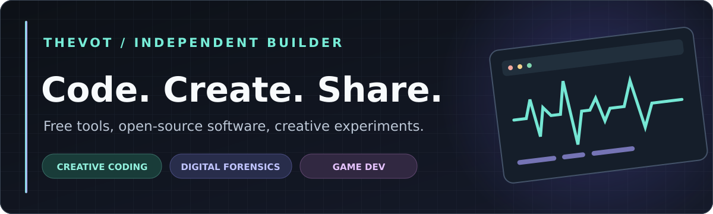
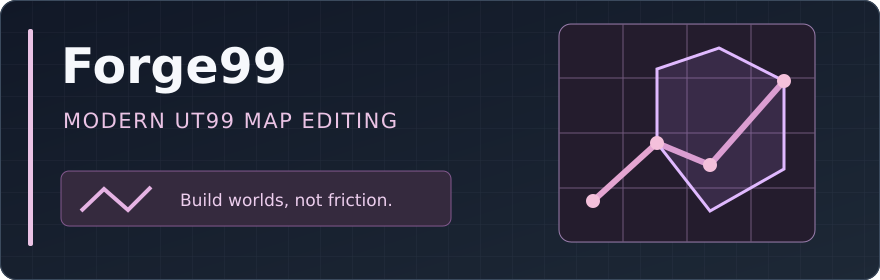
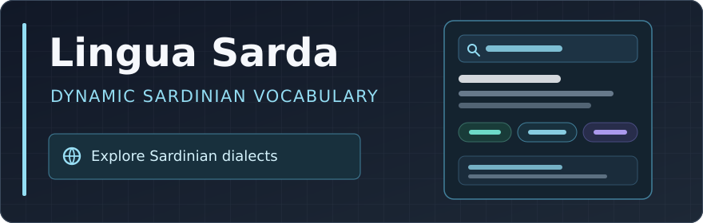
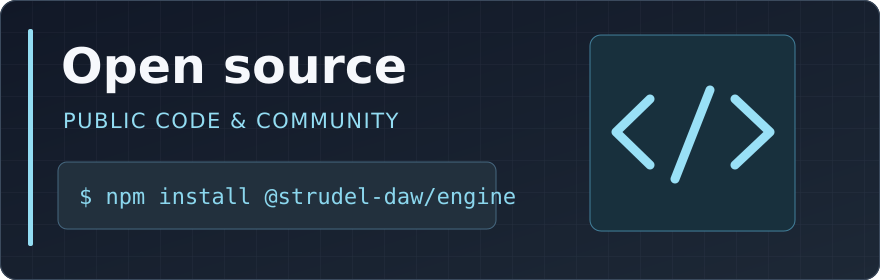

  

  
<strong>Email Deliverability &amp; Security Leader &nbsp;·&nbsp; Trust &amp; Safety Management (incl. Google) &nbsp;·&nbsp; International Speaker &nbsp;·&nbsp; Independent Builder (theVot)</strong>

  

    <a href="https://nicolaselenu.com">nicolaselenu.com</a> &nbsp;•&nbsp;
    <a href="https://nicolaselenu.com/speaking/">Speaking</a> &nbsp;•&nbsp;
    <a href="https://www.linkedin.com/in/selenu/">LinkedIn</a> &nbsp;•&nbsp;
    <a href="https://www.youtube.com/@NicolaSelenu">YouTube</a> &nbsp;•&nbsp;
    <a href="https://blog.nicolaselenu.com">Blog (IT)</a> &nbsp;•&nbsp;
    <a href="https://github.com/sponsors/thevot">Sponsor</a>
  

  

## Hey, I'm Nicola

I'm **Nicola Selenu**, known online for open-source and independent software as **theVot**.

I bring **20+ years** across **email deliverability, email authentication (`SPF`, `DKIM`, `DMARC`), cyber security, and Trust &amp; Safety Management (incl. Google)**, and I'm an active member of **M3AAWG** and **CSA** (see [nicolaselenu.com](https://nicolaselenu.com) and [deliverability.email](https://deliverability.email)). **theVot** is my engineering lab where I build **free web tools**, **open-source software**, and practical **Cyber Security &amp; Flipper Zero** guides.

> **The thread across everything I build:** taking complex systems apart, finding their blind spots, and turning them into useful tools and clear explanations.

## Featured projects

<table>
  <tr>
    <td width="50%" valign="top">
      
      <h3><a href="https://github.com/thevot/Forge99">Forge99</a> · Open-source desktop app</h3>
      
A modern 64-bit 3D level editor and procedural arena suite for <em>Unreal Tournament '99</em>, written in Rust with <code>wgpu</code> (MIT / Apache-2.0) and prebuilt Windows, Linux, and macOS releases. <em>Independent community-driven project, not affiliated with Epic Games.</em>

      
<a href="https://github.com/thevot/Forge99">Explore Forge99 →</a> &nbsp;·&nbsp; <a href="https://github.com/thevot/Forge99/releases">Latest release</a>

    </td>
    <td width="50%" valign="top">
      
      <h3><a href="https://unred.actor">unred.actor</a> · Free online toolkit</h3>
      
A digital-forensics and document-redaction auditing toolkit designed to identify flawed redactions in documents and help teams redact sensitive information more safely.

      
<a href="https://unred.actor">Explore unred.actor →</a>

    </td>
  </tr>
  <tr>
    <td width="50%" valign="top">
      
      <h3><a href="https://strudaw.com">StruDAW</a> · Free browser DAW</h3>
      
A visual browser-based music-production workspace built around <a href="https://strudel.cc">Strudel</a> live coding, powered by the separate open-source <a href="https://github.com/thevot/strudel-engine">strudel-engine</a> audio engine (<code>AGPL-3.0-only</code>).

      
<a href="https://strudaw.com">Try StruDAW →</a> &nbsp;·&nbsp; <a href="https://github.com/thevot/strudel-engine">Engine source</a>

    </td>
    <td width="50%" valign="top">
      
      <h3><a href="https://linguasarda.it">Lingua Sarda</a> · Cultural web platform</h3>
      
An independent dynamic vocabulary and interactive digital resource dedicated to exploring and preserving the Sardinian language and its dialects online.

      
<a href="https://linguasarda.it">Explore linguasarda.it →</a>

    </td>
  </tr>
</table>

## Open-source repositories

  

- **[Forge99](https://github.com/thevot/Forge99)**: dual-licensed (`MIT / Apache-2.0`) 64-bit Rust (`wgpu`) 3D level editor and procedural arena suite for *Unreal Tournament '99*, with prebuilt releases for Windows, Linux, and macOS. *(Independent community-driven project, not affiliated with Epic Games.)*
- **[strudel-engine](https://github.com/thevot/strudel-engine)**: the `AGPL-3.0-only` JavaScript audio engine powering StruDAW's Strudel-based live-coding workflow.
- **[CBR2CBZ](https://github.com/thevot/CBR2CBZ)**: an `MIT`-licensed Windows batch converter for `.cbr` comic archives to `.cbz` with NAS-friendly processing.

**More tools &amp; ecosystem:** [deliverability.email](https://deliverability.email) *(email audit &amp; troubleshooting suite)* · [mktg.tools](https://mktg.tools) *(free dev &amp; SEO utilities)* · [blog.nicolaselenu.com](https://blog.nicolaselenu.com) *(Italian tech blog &amp; Flipper Zero guide)* · [sele.nu](https://sele.nu) *(stand-up comedy showcase)*.

## Speaking, videos & writing

- **International Speaking &amp; Speaker Kit:** keynotes, technical talks, and workshops on email security, digital forensics, and technical storytelling → **[nicolaselenu.com/speaking](https://nicolaselenu.com/speaking/)**
- **LinkedIn:** email deliverability insights, security lessons, and build logs → **[linkedin.com/in/selenu](https://www.linkedin.com/in/selenu/)**
- **YouTube (`@NicolaSelenu`):** practical Cyber Security, **Flipper Zero** hardware tutorials, and practical tech demos → **[youtube.com/@NicolaSelenu](https://www.youtube.com/@NicolaSelenu)**
- **Italian Technical Blog:** 165+ articles, video companion notes, and tutorials → **[blog.nicolaselenu.com](https://blog.nicolaselenu.com)**

## Keep independent development going

These projects stay free to inspect and use whether or not anyone sponsors them. If you'd like to support hosting, maintenance, documentation, and future open-source releases, voluntary sponsorship is available on GitHub Sponsors (no commercial SLAs or paywalled features).

**[Become a sponsor](https://github.com/sponsors/thevot)**

Whether you sponsor, star a repository, report an issue, or share a tool with someone who needs it, thank you for the support.
