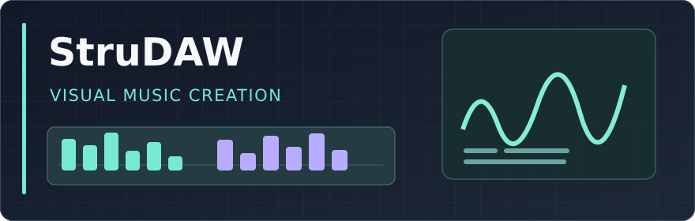
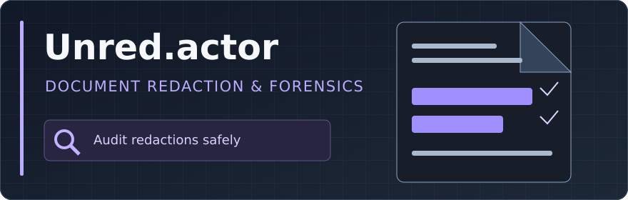

  

  
<strong>Independent developer &amp; YouTube creator</strong>

  

    <a href="https://strudaw.com">StruDAW</a> &nbsp;•&nbsp;
    <a href="https://unred.actor">Unred.actor</a> &nbsp;•&nbsp;
    Forge99 &nbsp;•&nbsp;
    <a href="https://github.com/sponsors/thevot">Support my work</a>
  

  

## Hey, I'm Nicola 👋

I'm an independent developer and content creator building **free web tools**, **creative software**, and **open-source components**.

I like taking complex ideas and turning them into tools that people can actually use — from making music in the browser to auditing document redactions and building worlds for classic games.

**My goal:** make useful technology easier to access, experiment with, and learn from.

## Featured projects

<table>
  <tr>
    <td width="50%" valign="top">
      
      <h3><a href="https://strudaw.com">StruDAW</a> · Live web app</h3>
      
A visual music-production workspace built around <a href="https://strudel.cc">Strudel</a>. Explore live-coded patterns through a more hands-on DAW experience.

      
<a href="https://strudaw.com">Try StruDAW →</a>

    </td>
    <td width="50%" valign="top">
      
      <h3><a href="https://unred.actor">Unred.actor</a> · Free online tool</h3>
      
A digital-forensics and document-redaction toolkit for identifying flawed redactions and helping people redact information more safely.

      
<a href="https://unred.actor">Explore Unred.actor →</a>

    </td>
  </tr>
  <tr>
    <td width="50%" valign="top">
      
      <h3>Forge99 · In development</h3>
      
A modern map editor for <em>Unreal Tournament '99</em>, created for people who still love building worlds for classic games.

      
<em>Development updates and release details will follow.</em>

    </td>
    <td width="50%" valign="top">
      
      <h3>Open-source work · Available now</h3>
      
I publish code and tools that others can inspect, use, and contribute to — including the StruDAW audio engine and a comic-archive conversion utility.

      
<a href="https://github.com/thevot?tab=repositories">Browse repositories →</a>

    </td>
  </tr>
</table>

## Open-source repositories

- 🎛️ **[strudel-engine](https://github.com/thevot/strudel-engine)** — the AGPLv3-licensed audio engine that powers StruDAW's Strudel-based workflow.
- 📚 **[CBR2CBZ](https://github.com/thevot/CBR2CBZ)** — a MIT-licensed Windows batch converter for `.cbr` comic archives to `.cbz`.

More public releases are planned as my projects evolve.

## Videos, ideas & the process

I also create videos on YouTube. Building and sharing are connected for me: I enjoy making things, learning in public, and explaining ideas along the way.

<!-- Optional: add your VERIFIED YouTube channel URL here.
[Watch on YouTube](https://www.youtube.com/your-verified-channel)
-->

## Keep independent development going 💜

These tools take time to design, build, test, host, document, and maintain. If you find my work useful, **GitHub Sponsors is a direct way to help me keep creating**.

**[❤️ Become a sponsor](https://github.com/sponsors/thevot)**

Whether you sponsor, star a repository, report an issue, or share a project with a friend — thank you for being part of it.
